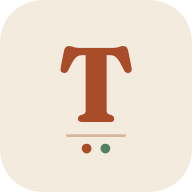

<p align="center">
  
</p>

<h1 align="center">Telescreen</h1>

<p align="center">
  Your family day, on the wall.
</p>

<p align="center">
  <a href="LICENSE"></a>
  
  
</p>

<p align="center">
  <a href="#about">About</a> ·
  <a href="#features">Features</a> ·
  <a href="#quick-start">Quick start</a> ·
  <a href="#documentation">Documentation</a> ·
  <a href="#contributing">Contributing</a> ·
  <a href="#license">License</a>
</p>

## About

Telescreen is a self-hosted wall display for a family: a big calendar that
merges Google and iCloud calendars, recurring and rotating chores, and a row of
optional widgets for weather, driving times, meals from PantryPal, and Spotify.
It runs as a single Docker container on your private network and installs to an
iPad or tablet as a PWA. No cloud account, no subscription, no telemetry.

## Features

- **One calendar, both people:** Google and iCloud calendars side by side,
  color-coded per person, with Family events in a neutral style.
- **Write from the wall:** create, edit, and delete events (including simple
  recurring events) from the event sheet; writes go to the provider first.
- **Chores that fit real life:** one-off, daily, weekday, weekly, every-N-weeks,
  and monthly chores; fixed, rotating, or "either of us" assignment; tap to
  complete and undo.
- **Built for a screen:** light and dark themes, large touch targets, screen
  wake lock, idle return to today, and layouts from a wall display down to a
  phone.
- **Optional widgets:** weather from Open-Meteo, Google Routes driving times,
  meals and shopping from PantryPal, and Spotify now-playing with playback
  controls.

## Quick start

Requires Docker and a private network such as Tailscale.

```sh
git clone https://github.com/dev-arekusandoru/telescreen.git
cd telescreen
cp .env.example .env                      # set TELESCREEN_SECRET_KEY
mkdir -p data                             # must be writable by uid 1000
docker compose up -d --build              # serves 127.0.0.1:8788
tailscale serve --bg 8788                 # HTTPS on your tailnet
```

Open the tailnet URL, then follow [First run](docs/start/first-run.md). The
[Install guide](https://dev-arekusandoru.github.io/telescreen/start/install)
covers the data directory, non-443 HTTPS ports, and the optional modules. Keep
`TELESCREEN_SECRET_KEY` (`openssl rand -hex 32`): it encrypts connected account
credentials and losing it means reconnecting them.

## Documentation

[Read the documentation](https://dev-arekusandoru.github.io/telescreen) for
installation, guides, hosting, and reference. It is built from [`docs/`](docs/)
with VitePress and published to GitHub Pages.

## Contributing

Read the [contribution guide](docs/develop/contributing.md) to report a bug,
suggest a change, or submit a pull request. Local setup and checks are in
[Develop and contribute](docs/develop/setup.md).

## License

Telescreen uses the [MIT license](LICENSE).

- UI icons: [Phosphor](https://phosphoricons.com),
  [MIT](https://github.com/phosphor-icons/react/blob/master/LICENSE).
- Fonts: [Fraunces](https://github.com/undercasetype/Fraunces) and
  [Inter](https://github.com/rsms/inter), SIL Open Font License.
- Weather: [Open-Meteo](https://open-meteo.com), free for non-commercial use.
